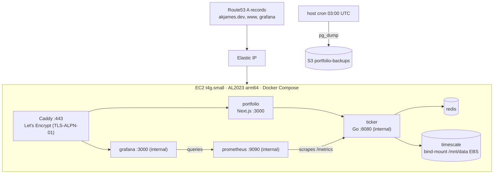
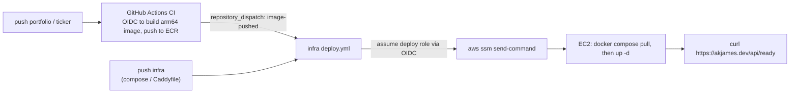

# infra

[](https://github.com/AkashJam/infra/actions/workflows/deploy.yml)

The deploy plane for [akjames.dev](https://akjames.dev) — Terraform-provisioned
AWS, one `t4g.small` running the whole stack in Docker Compose behind Caddy,
keyless CI/CD over GitHub OIDC.

This repo owns nothing but *where things run*: the EC2 box, its networking and
IAM, the Compose file that starts every service on it, TLS, and the deploy
pipeline. The two application repos —
[`portfolio`](https://github.com/AkashJam/portfolio) (Next.js) and
[`ticker`](https://github.com/AkashJam/ticker) (Go) — each just build and push
an image; they share nothing else with this repo or with each other.


<!-- TODO: capture https://akjames.dev (or a rendered topology diagram) and commit it as docs/screenshot.png -->

## Runtime topology



One box, deliberately — not a multi-service cloud topology. A personal site's
real traffic doesn't justify one, and a topology sized for scale it will never
see isn't a stronger engineering statement, just a more expensive one. Caddy
terminates TLS via the `TLS-ALPN-01` challenge on 443 only (the security group
opens nothing else — no port 80, no SSH; operator shell access is
`aws ssm start-session`). `ticker`'s API is `expose`d on the Compose network
only, never given a public route: `portfolio` is the sole public origin and
proxies reads/SSE to it server-side. TimescaleDB's data directory is
bind-mounted to a separate EBS volume at `/mnt/data`, so it survives an
instance replacement; a host crontab runs a nightly `pg_dump` off that volume
to S3.

## What Terraform provisions

Lives under [`terraform/`](terraform). Root module wires five sub-modules plus
two S3 buckets:

| Module | Provisions |
|---|---|
| [`ecr`](terraform/modules/ecr) | Two image repos (`portfolio`, `ticker`), scan-on-push, a lifecycle policy keeping the last 10 tagged images |
| [`iam`](terraform/modules/iam) | The GitHub OIDC provider; a **CI role** (assumable from either app repo, any ref — ECR push only); a **deploy role** (assumable from this repo, `main` only — `ssm:SendCommand` scoped to the tagged instance); the **EC2 instance role** (ECR pull, scoped SSM parameter reads, S3 read/write for releases/backups) |
| [`ssm`](terraform/modules/ssm) | Generated secrets stored as SSM `SecureString`s: a 32-char alphanumeric DB password and a 24-char Grafana admin password — the DB password is never typed or seen by a human, the Grafana one is retrievable via `terraform output -raw grafana_admin_password` |
| [`ec2`](terraform/modules/ec2) | The instance itself (AL2023 arm64, `t4g.small`), its security group (443 only), Elastic IP, the separate data EBS volume, and `user_data` that installs Docker/Compose and formats/mounts that volume — but starts no containers; what runs is entirely owned by `deploy.yml` |
| [`dns`](terraform/modules/dns) | Route53 `A` records for the apex, `www`, and `grafana`, and adopts the (separately, imperatively registered) domain into state |

Two S3 buckets sit at the root: `portfolio-releases-<account>` (the deploy
workflow's staging area for `docker-compose.yml`/`Caddyfile`/`backup.sh`/`monitoring/`) and
`portfolio-backups-<account>` (nightly dumps, 30-day lifecycle expiry).
[`terraform/bootstrap/`](terraform/bootstrap) is a separate, one-time module
that creates the S3 bucket this root module uses as its remote state backend —
state locking is native S3 (`use_lockfile`), no DynamoDB table.

## Deploy flow



`portfolio` or `ticker` CI pushing a new image fires a `repository_dispatch`
here, since a bare image push doesn't touch `docker-compose.yml`. This repo's
own [`deploy.yml`](.github/workflows/deploy.yml) also runs on a push to `main`
that touches `docker-compose.yml`/`Caddyfile`, or on manual
`workflow_dispatch`. Every trigger does the same thing: assume the deploy role
over OIDC, sync `docker-compose.yml`/`Caddyfile`/`backup.sh`/`monitoring/` to
the releases bucket, resolve the running instance by its `Name` tag, then
`aws ssm send-command` on the box to fetch the DB password from SSM and run
`docker compose pull && up -d`. No static AWS credentials exist in any of the
three repos.

## First-time setup

1. Attach [`bootstrap-iam-policy.json`](bootstrap-iam-policy.json) to the IAM
   identity you'll run Terraform as.
2. `cd terraform/bootstrap && terraform init && terraform apply`, then copy
   its `state_bucket` output into `terraform/environments/prod/backend.hcl`.
3. `make init && make apply` (see targets below).
4. Register the domain out-of-band — `aws route53domains register-domain …`
   (multi-hour latency makes this a poor fit for Terraform's apply graph).
5. Set GitHub repo configuration from the root module's outputs:
   `AWS_ROLE_ARN` on `portfolio` and `ticker`; `AWS_DEPLOY_ROLE_ARN`,
   `RELEASE_BUCKET`, `AWS_REGION` on this repo.
6. Optional: once you have a [healthchecks.io](https://healthchecks.io) check,
   `aws ssm put-parameter --name /portfolio/prod/healthchecks-url --type SecureString --value <url>` —
   `ticker`'s dead-man switch stays a no-op until this exists.
   For the Phase 8 daily-bar sweep, add two more the same way:
   `/portfolio/prod/finnhub-api-key` (the Finnhub key) and
   `/portfolio/prod/healthchecks-sweep-url` (a second healthchecks.io check,
   weekdays only). The deploy tolerates either being absent.
   For the Phase 10 Atlas reference fetchers, one more:
   `/portfolio/prod/healthchecks-reference-url` (a third check, daily, ~26h
   period). They are keyless, so there is no key to add; the deploy tolerates
   its absence.
7. After `make apply`, run `terraform output -raw grafana_admin_password` (from
   `terraform/`) to get the Grafana login — username `admin`, at
   `https://grafana.akjames.dev`. Prometheus itself has no site block/UI of
   its own; it's reached only from Grafana over the internal Docker network.

## Make targets

| Target | Runs |
|---|---|
| `make init` | `terraform init -backend-config=environments/prod/backend.hcl` |
| `make fmt` | `terraform fmt -recursive` |
| `make validate` | `terraform validate` |
| `make plan` | `terraform plan -var-file=environments/prod/prod.tfvars` |
| `make apply` | `terraform apply -var-file=environments/prod/prod.tfvars` |
| `make destroy` | `terraform destroy -var-file=environments/prod/prod.tfvars` |
| `make deploy` | Manually triggers the `Deploy` workflow (`gh workflow run`) — normally this fires on its own after a push, see Deploy flow above |

**Always run Terraform through these targets (or pass
`-var-file=environments/prod/prod.tfvars` yourself) — never a bare
`terraform plan`/`apply`.** `github_owner` has no default, so a bare
invocation prompts for it interactively instead of erroring, and `tags`
silently falls back to `{}`; a mistyped value at that prompt (a 2026-09
incident: an email address instead of `AkashJam`) goes straight into the
OIDC trust policy and breaks every deploy.

There's deliberately no `make dev` here — this repo doesn't run a dev server;
its unit of work is a Terraform apply or a triggered deploy, both covered
above.

## Repo layout

```text
terraform/main.tf              root module — S3 buckets, wires the 5 sub-modules
terraform/{variables,outputs,backend}.tf
terraform/modules/             ecr, iam, ssm, ec2, dns
terraform/bootstrap/           one-time remote-state bucket (local state, run once)
terraform/environments/prod/   backend.hcl + prod.tfvars
docker-compose.yml             the 8 services that run on the box
Caddyfile                      TLS + reverse proxy
monitoring/                    prometheus.yml scrape config + grafana provisioning/dashboards
backup.sh                      nightly pg_dump → S3, run via host crontab
.github/workflows/deploy.yml   the deploy pipeline described above
```

## Operating the box

There's no SSH — shell access is `aws ssm start-session --target <instance-id>`.
The session starts as `ssm-user` outside the app directory, so first run `sudo -i` and
`cd /opt/app` (the deploy keeps `docker-compose.yml` there); then `docker compose logs -f <service>`
for any of `portfolio`, `ticker`, `redis`, `timescale`, `prometheus`, `grafana`, or `caddy`.
Compose warns that `ECR_REGISTRY`, `DB_PASSWORD` and the other deploy-time variables are unset;
that only matters when containers are created, so `logs`, `ps` and `exec` are unaffected. Backups
land in `s3://portfolio-backups-<account>/<timestamp>.dump`; restore with `pg_restore` against a
`docker compose exec timescale` shell.

## After a deploy: `/atlas` fills in on its own

`/atlas` is empty for a while after every deploy: it says *Atlas data is temporarily unavailable*
until the ticker has fetched its reference data (the Atlas fetchers run on a schedule and fill Redis
as they finish), and the page is a cached render that refreshes at most once an hour. It has behaved
this way after earlier deploys too. It is not a fault, and nothing needs doing; if it is still empty
after about an hour, check the ticker's logs for the reference fetchers (`docker compose logs ticker | grep -i reference`)
and the `HEALTHCHECKS_REFERENCE_URL` check.

## Rolling back a release

Each CI build pushes its image twice, as `<repo>:<commit sha>` and `<repo>:latest`, and the deploy
always pulls `latest`. Rolling back is therefore a retag followed by a redeploy, with no rebuild:

1. Pick the last good commit of the repository to roll back (`portfolio` or `ticker`).
2. Point `latest` at that commit's image in ECR (from a machine with ECR rights):

   ```bash
   MANIFEST=$(aws ecr batch-get-image --repository-name ticker --image-ids imageTag=<good-sha> --query 'images[0].imageManifest' --output text)
   aws ecr put-image --repository-name ticker --image-tag latest --image-manifest "$MANIFEST"
   ```

3. Run the **Deploy** workflow by hand (it accepts `workflow_dispatch`); it pulls the retagged
   `latest` and recreates the containers.
4. Revert or fix the bad commit before the next push to `main`, which would otherwise rebuild and
   retag `latest` over the rollback.

**A rollback of `ticker` past a migration needs that migration undone first.** `ticker` starts only
after the one-shot `ticker-migrate` succeeds, and `ticker migrate` only applies migrations upward:
an older image does not contain the newer migration's files, and golang-migrate refuses a
database whose current version is missing from its source, so the older image would not start.
Before retagging, undo the newer migrations by hand, newest first: run each
`ticker/migrations/<n>_*.down.sql` in `psql` inside the `timescale` container, then set
`schema_migrations` back to the older version (`UPDATE schema_migrations SET version = <n-1>, dirty = false;`).
For migration `000006` (the Yahoo backfill) the down file only deletes the backfilled rows; if the
rows are wanted, setting the version back without running it is enough.

## Promoting the feed (Phase 14 step 10)

Production's `ticker` runs `SOURCE=sim` until the adapter is promoted, and the promotion is its own
commit so that a problem in a release and a problem in the real feed are never tangled:

1. **Release the code first**, with `SOURCE=sim` still in `docker-compose.yml`: merge `ticker`, then
   `portfolio`, to `main`. Each CI run pushes its image and fires **Deploy**.
2. Check the public site (nothing here needs the box): `/api/ready`, `/api/market-state`, `/market`,
   `/market/MUFG`. On the simulator `/market/state` always says `open`, the sensors have no simulated
   ticks, and `/market/SIM:NOVA` is still 200; that is expected until step 3.
3. **Flip the feed**: change `SOURCE=sim` to `SOURCE=finnhub` under `ticker` in `docker-compose.yml`,
   commit and push to `main`. The path filter fires **Deploy**, which recreates `ticker` (only it:
   nothing else changed). `FINNHUB_API_KEY` is already passed to it from SSM
   (`/portfolio/prod/finnhub-api-key`); the ticker refuses to start with `finnhub` and no key.
4. **Watch it** (`sudo -i`, `cd /opt/app`):

   ```bash
   docker compose ps                         # ticker should not be restarting
   docker compose logs --tail 80 -f ticker   # the WebSocket connects and subscribes to 18 symbols;
                                             # watch for 401 (key) or 429 (rate), and for reconnect loops
   docker compose exec redis redis-cli XLEN ticks:raw    # climbs in US hours, capped near 100000
   ```

5. **The gate**, during US hours (13:30–20:00 UTC), from `portfolio/`: `npm run test:prod`. It fails
   rather than skipping when the market is closed or the feed is not live, and prints a `GATE:` line
   (symbol, price, the quote's own time) for `phase14.md`.

## What a rollback means once the simulator is gone

The `simulated` flag was removed in Phase 14 (the price's vintage, `asOf`, replaced it), so **setting
`SOURCE=sim` back in production is not a rollback**: it would show random walks as real prices, with
nothing on the page to say so. The options are:

- **The feed is misbehaving** (a reconnect loop, wrong prices, rate limits): leave `SOURCE=finnhub`
  and let the page degrade honestly. A dead feed shows the amber stale pill and `Unreachable.`; a
  quiet one shows `Closed.` with the last session. Fix forward, or stop the ticker.
- **The release is bad**: retag `latest` to the last good image as in *Rolling back a release* above.
  Rolling `ticker` back past Phase 14 means a pre-`asOf` image, which expects `updatedAt` and a
  `simulated` flag the new `portfolio` no longer reads, so roll both back together.
- **Old `SIM:` rows** from the simulator stay in the database and Redis. The ticker does not serve
  them under `finnhub`, so nothing links to them and `/market/SIM:*` is a 404.
